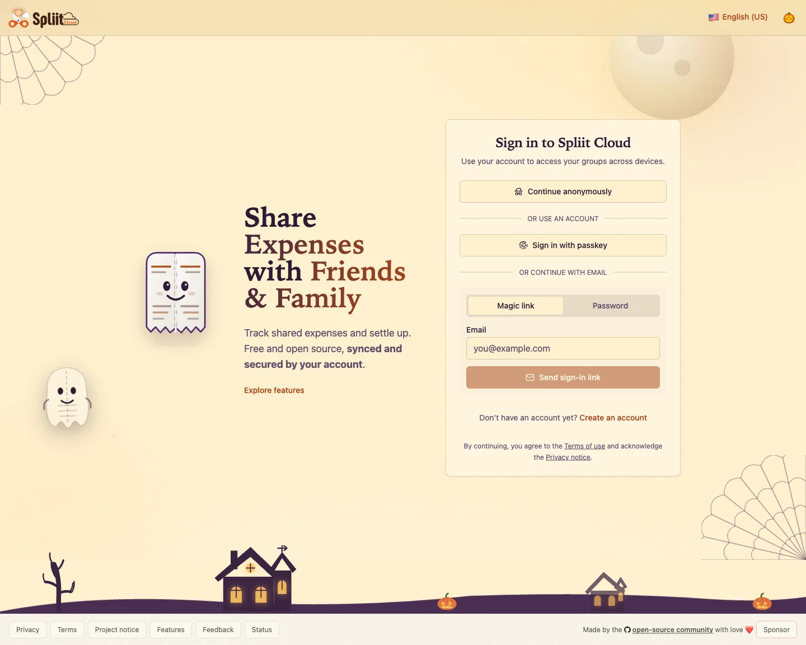

Welcome to `v2.10.2`: Spliit gets a haunted Halloween makeover, plus a fix that keeps recurring schedules stable through daylight-saving changes.

## Highlights

### Spliit gets haunted

From October 30 through November 1, Spliit dresses up with moonlit scenery, cobwebs, haunted houses, and ghost Bill. The appearance works in light and dark mode, respects reduced-motion preferences, and leaves financial status colors and printed reports untouched. Prefer the normal look? Turn off **Halloween effects** in the appearance menu; the choice is remembered in this browser.

## What's Changed

### 🚀 Features

- Halloween appearance: Spliit dresses up with haunted scenery and seasonal colors from October 30 through November 1, with an appearance switch that remembers your opt-out in this browser ([`d2c1b5d7`](https://github.com/antonio-ivanovski/spliit-cloud/commit/d2c1b5d75be9d43bb3f87ee951d535ab4dd3fcff) by @antonio-ivanovski)

### 🐛 Bug fixes

- Recurring entries scheduled at a wall time repeated by a daylight-saving fall-back now consistently use the earlier occurrence, independent of the server's timezone data ([`0f0e3ec1`](https://github.com/antonio-ivanovski/spliit-cloud/commit/0f0e3ec17b321af51244f13d7665431b4e2bee3c) by @antonio-ivanovski)

**Full Changelog**: [v2.10.1...v2.10.2](https://github.com/antonio-ivanovski/spliit-cloud/compare/v2.10.1...v2.10.2)
