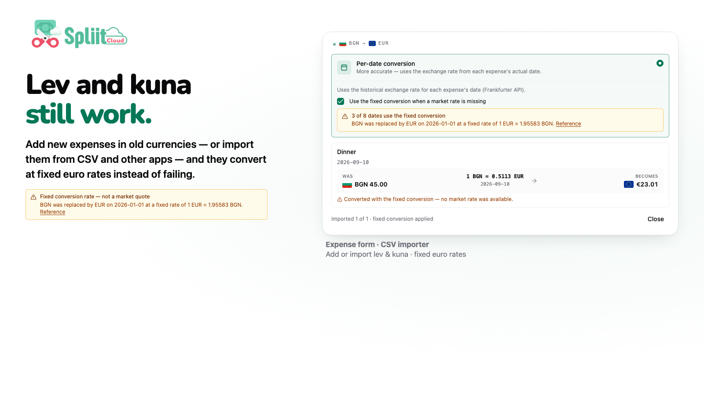
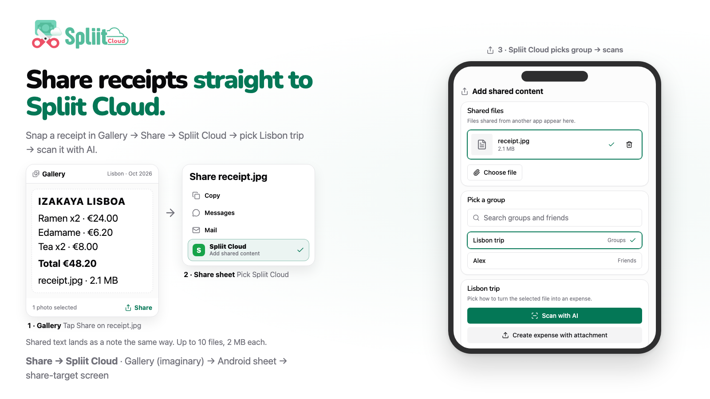

Welcome to `v2.8.0`! Currency tools get flexible, legacy money keeps working, and Android sharing lands — plus richer invites, smarter notifications, and faster pages.

## Highlights

- Change the group settlement currency anytime
- Lev and kuna still work for new expenses and imports
- Share receipts straight to Spliit Cloud

### Change the group settlement currency anytime

Change the group settlement currency anytime — the currency swap tool takes care of every exchange rate, with per-pair historic per-expense or fixed rates and a per-row Was / rate / Becomes preview before anything changes. Groups also get a new default entry currency besides the ledger currency, so new expenses start in the trip currency while settling at home. The tool is ADMIN-only and stays disabled while offline or on archived groups.

### Lev and kuna still work for new expenses and imports

Keep adding expenses in Bulgarian lev and Croatian kuna — or import them from CSV and other apps — and they convert at their irrevocable euro rates (1 EUR = 1.95583 BGN, 1 EUR = 7.5345 HRK) instead of failing with missing-rate errors. Per-date conversion offers a checked "Use the fixed conversion when a market rate is missing" fallback with a compact count of fixed dates, plus amber banners naming the currency, withdrawal date, and rate in the expense form, importer, and converter. Fallback conversions raise a warn-only "Needs attention" flag that never blocks Continue.

### Share receipts straight to Spliit Cloud

Receipts can now be shared straight into Spliit Cloud from other Android apps: Share → Spliit Cloud opens a page where you pick the group or friend, then either scan with AI or attach to a manually created expense. Shared text can be attached as a note the same way. Up to 10 files, 2 MB each.

## What's Changed

### 🚀 Features

- Group invite links and read-only view links now unfurl rich previews with the group's emoji, name, member count, inviter, and member avatars (friend ledgers get a two-avatar card; used-up links fall back to a generic card). ([`16e17ba1`](https://github.com/antonio-ivanovski/spliit-cloud/commit/16e17ba139e6aab590fc97b9c3d1cb4394e0aadd) by @antonio-ivanovski)
- Expense notifications now include more context: new-expense emails show the category, payer, and group size, and push alerts include the amount, group, and payer alongside your share. ([`c2dd2720`](https://github.com/antonio-ivanovski/spliit-cloud/commit/c2dd27207c0ba3d7b80fae2bb283ad54a23e176b) by @antonio-ivanovski)
- Groups can now set a default entry currency separate from settlement, so new expenses start in the trip currency but settle in the home currency. Thanks @alopix for opening [#160](https://github.com/antonio-ivanovski/spliit-cloud/issues/160). ([`3e6b257f`](https://github.com/antonio-ivanovski/spliit-cloud/commit/3e6b257fd7cc2cb731c5bd1d599aca9d6ae34e4d) by @antonio-ivanovski)
- Groups can now swap the settlement currency with per-pair rates, per-row preview, and attention-only review — see highlight. Thanks @alopix for opening [#160](https://github.com/antonio-ivanovski/spliit-cloud/issues/160). ([`7b3c9670`](https://github.com/antonio-ivanovski/spliit-cloud/commit/7b3c967046b347c74972bd017b4c255af3ea5cc6) by @antonio-ivanovski)
- Per-date conversions involving a withdrawn currency now offer an explicit fixed-rate fallback in the swap tool and importer — see highlight. ([`1855a825`](https://github.com/antonio-ivanovski/spliit-cloud/commit/1855a825ee83d3c73ff44c6b54f04ab7b6db06df) by @antonio-ivanovski)
- Receipts can now be shared from Android apps via Share → Spliit Cloud — see highlight. Thanks @alopix for opening [#159](https://github.com/antonio-ivanovski/spliit-cloud/issues/159). ([`9e1936a2`](https://github.com/antonio-ivanovski/spliit-cloud/commit/9e1936a2d2194393a46e7a009f67ee5502e3ca59) by @antonio-ivanovski)

### 🐛 Bug fixes

- Receipt scan preview no longer warns on rounding-size gaps: differences within the currency's rounding tolerance resolve to the receipt total with a muted note. ([`a8e9a44e`](https://github.com/antonio-ivanovski/spliit-cloud/commit/a8e9a44e6c7cc6d490064a24fa85942b7259b36a) by @antonio-ivanovski)
- Bulgarian lev and Croatian kuna convert again after euro adoption through their fixed euro rates, explained in place. ([`1855a825`](https://github.com/antonio-ivanovski/spliit-cloud/commit/1855a825ee83d3c73ff44c6b54f04ab7b6db06df) by @antonio-ivanovski)
- Withdrawn currencies now show an amber banner with the withdrawal date, statutory rate, and reference link wherever a rate is shown. ([`1855a825`](https://github.com/antonio-ivanovski/spliit-cloud/commit/1855a825ee83d3c73ff44c6b54f04ab7b6db06df) by @antonio-ivanovski)
- Currency swap review rows now stretch full width so long amounts and fixed-conversion notes stop truncating. ([`1855a825`](https://github.com/antonio-ivanovski/spliit-cloud/commit/1855a825ee83d3c73ff44c6b54f04ab7b6db06df) by @antonio-ivanovski)
- Home, expenses, and group pages now load without flashes or duplicate requests, holding layout through pending states and filter changes. ([`671df7a0`](https://github.com/antonio-ivanovski/spliit-cloud/commit/671df7a0742f00cff692954a36e19f7096a4467d) by @antonio-ivanovski)
- Split by amount no longer wipes custom shares when the total changes: uneven splits survive as a footer mismatch, with Set expense amount to derive the total from shares. Thanks @Commit25uccess for opening [#156](https://github.com/antonio-ivanovski/spliit-cloud/issues/156). ([`0b980009`](https://github.com/antonio-ivanovski/spliit-cloud/commit/0b980009169121f0c5267288077b2296069a79ad) by @antonio-ivanovski)
- Offline reading recovers automatically after the milli-units upgrade: snapshots cached by older versions re-download on the next sync instead of staying stuck offline until storage is cleared manually. ([`f74757ba`](https://github.com/antonio-ivanovski/spliit-cloud/commit/f74757baf12295382f8b7901dc2c19555ece469c) by @antonio-ivanovski)

**Full Changelog**: [v2.7.0...v2.8.0](https://github.com/antonio-ivanovski/spliit-cloud/compare/v2.7.0...v2.8.0)
