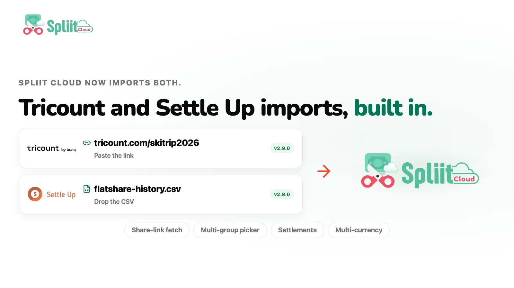

Welcome to `v2.9.0`! Bring your Tricount and Settle Up groups with you — plus Android app prep for private testing and a smoother share-to-Spliit flow.

## Highlights

- Bring your Tricount and Settle Up groups with you

### Bring your Tricount and Settle Up groups with you

Paste a Tricount share link and Spliit Cloud fetches the group server-side — no GDPR request needed — or drop a Tricount GDPR CSV or Settle Up history CSV. Multi-group Tricount dumps get a picker with per-group counts, settlements and income come across, and multi-currency amounts convert with historic rates at confirm time. Each input carries its own step-by-step export guide.

## What's Changed

### 🚀 Features

- Spliit Cloud is getting ready for its Android app, with website verification, Android integration, and signed release tooling for private testing. No public APK is included in this release ([`fc07f199`](https://github.com/antonio-ivanovski/spliit-cloud/commit/fc07f199d6bf37a6b456981fec56eb75e9dbde5e) by @antonio-ivanovski)
- Import Tricount groups from a share link or GDPR CSV export, with a multi-group picker — see highlight ([`7b2b7038`](https://github.com/antonio-ivanovski/spliit-cloud/commit/7b2b7038855b3d87a69153e2cd48f8449d661f8d) by @antonio-ivanovski)
- Import a Settle Up group from a CSV history export, with settlements, income, and currency conversion — see highlight ([`7b2b7038`](https://github.com/antonio-ivanovski/spliit-cloud/commit/7b2b7038855b3d87a69153e2cd48f8449d661f8d) by @antonio-ivanovski)
- Every importer input now carries its own step-by-step export guide, so the help answers the exact input it sits next to ([`7b2b7038`](https://github.com/antonio-ivanovski/spliit-cloud/commit/7b2b7038855b3d87a69153e2cd48f8449d661f8d) by @antonio-ivanovski)
- Sharing into Spliit Cloud lands on the expense preview now, with a read-only file summary and a full-page searchable group picker; back never returns to the share page. Thanks @alopix for opening [#159](https://github.com/antonio-ivanovski/spliit-cloud/issues/159). ([`3b24b1ab`](https://github.com/antonio-ivanovski/spliit-cloud/commit/3b24b1abd0de5c6434ef34d7ece4dfc3a4e2124d) by @antonio-ivanovski)

### 🐛 Bug fixes

- Long expense titles in the expense details dialog now truncate with an ellipsis instead of overflowing the dialog ([`6e7f56a3`](https://github.com/antonio-ivanovski/spliit-cloud/commit/6e7f56a3560f732c5303ebaf3308ce4a0dfeea92) by @antonio-ivanovski)

**Full Changelog**: [v2.8.0...v2.9.0](https://github.com/antonio-ivanovski/spliit-cloud/compare/v2.8.0...v2.9.0)
