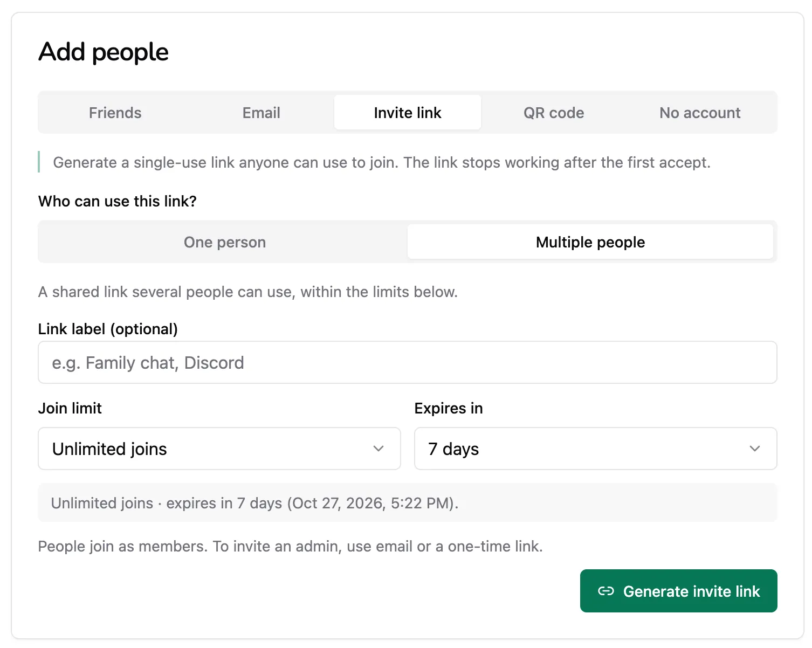
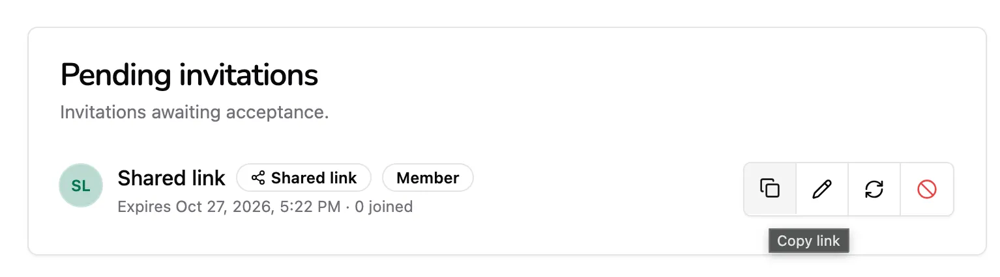
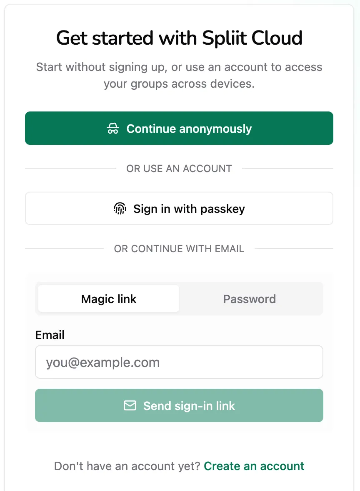

Welcome to `v2.9.1`! Share one invitation link with your whole group, keep access through sign-in and setup, and apply bulk changes to recurring expenses with more control.

## Highlights

### One invite link for several people

Create a shared invitation for a family chat, trip, or community. Choose a join limit and expiry, or start with unlimited joins for seven days. Copy the link again from pending invitations, edit its limits, rotate it, or revoke it when you are done.

### Easier to get started, safer to return

Anonymous access is now the first option on the getting-started screen. Group viewing and invitation tokens survive authentication and account setup; choosing “Sign in to accept” takes you straight to the group's expenses after joining.

## What's Changed

### 🚀 Features

- Multi-person invite links support optional join limits and expiry, with unlimited joins for seven days by default. Members can copy links again, and creators or admins can edit limits, rotate links, or revoke them ([`7df71a56`](https://github.com/antonio-ivanovski/spliit-cloud/commit/7df71a56bea97c607c005cff891440e297800810) by @antonio-ivanovski)
- Bulk categorization can update selected recurring expenses, this and future occurrences, or a whole series, including the template used for future expenses. Recurring series, expense details, and the series dialog also flag categories that differ from their template ([`6f8dbbee`](https://github.com/antonio-ivanovski/spliit-cloud/commit/6f8dbbee7671bb54ab5764c6c7e0e2a7a30d74eb) by @antonio-ivanovski)
- Currency swap now converts recurring templates at today's rate alongside expenses, including paused and completed series ([`6f8dbbee`](https://github.com/antonio-ivanovski/spliit-cloud/commit/6f8dbbee7671bb54ab5764c6c7e0e2a7a30d74eb) by @antonio-ivanovski)
- File import confirmation explains when recurring rows are combined despite differing categories: the latest row's category wins ([`6f8dbbee`](https://github.com/antonio-ivanovski/spliit-cloud/commit/6f8dbbee7671bb54ab5764c6c7e0e2a7a30d74eb) by @antonio-ivanovski)

### 🐛 Bug fixes

- Anonymous access is now the first option, with clearer getting-started wording and branded social sign-in buttons. Thanks @sepulzera for opening [#162](https://github.com/antonio-ivanovski/spliit-cloud/issues/162) ([`36bc673f`](https://github.com/antonio-ivanovski/spliit-cloud/commit/36bc673f36f8c73535d41352e915274011b55aeb) by @antonio-ivanovski)
- OAuth API access now works when Cloudflare challenges the server's public signing-key endpoint, including after token refresh. Thanks @wi1k1n for opening [#161](https://github.com/antonio-ivanovski/spliit-cloud/issues/161) ([`079e690b`](https://github.com/antonio-ivanovski/spliit-cloud/commit/079e690be3f3ba6947bfb5a0b4792d4b0806feea) by @antonio-ivanovski)
- Group viewing and invitation links keep their access tokens through sign-in, signup, profile setup, and recovery, including emailed callbacks opened on another device. Choosing “Sign in to accept” joins the group after setup; opening an invitation otherwise still asks for confirmation ([`7df71a56`](https://github.com/antonio-ivanovski/spliit-cloud/commit/7df71a56bea97c607c005cff891440e297800810) by @antonio-ivanovski)
- Anonymous setup uses one stable profile and safeguard flow, avoiding lost display names and misleading “Downloads need updating” warnings. A late friends response no longer switches away from the invitation method you selected ([`7df71a56`](https://github.com/antonio-ivanovski/spliit-cloud/commit/7df71a56bea97c607c005cff891440e297800810) by @antonio-ivanovski)
- Offline downloads resume after connectivity interruptions even when a status or cross-tab notification fails ([`7df71a56`](https://github.com/antonio-ivanovski/spliit-cloud/commit/7df71a56bea97c607c005cff891440e297800810) by @antonio-ivanovski)
- The What's new dialog and announcement emails only reach accounts created before the announcement's publication date, so people who sign up later are not shown news that predates them ([`2c25f4d4`](https://github.com/antonio-ivanovski/spliit-cloud/commit/2c25f4d4fecaf78ddd07ed3d712ef944c83946a2) by @antonio-ivanovski)

**Full Changelog**: [v2.9.0...v2.9.1](https://github.com/antonio-ivanovski/spliit-cloud/compare/v2.9.0...v2.9.1)
